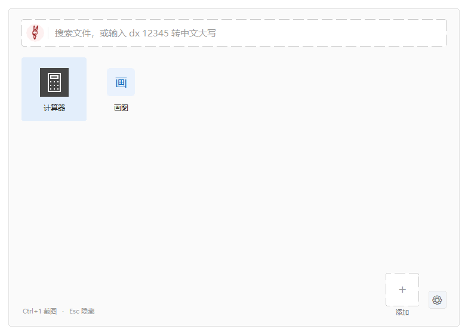

# TT酱

常驻托盘的 Windows 快速启动面板：固定 8×4 图标网格、双击 Ctrl 唤起、全盘文件搜索、截图离线 OCR 与表格识别。Rust + 原生 Win32 实现，零第三方 crate，单文件 exe 约 897 KB。



## 这是什么

- 托盘常驻，平时不占窗口。双击 Ctrl（或双击托盘图标）唤起面板，再按一次收起。
- 固定 8 列 × 4 行共 32 格，最后一格是「+ 添加」。磁贴可拖到任意格子，留空与互换都会记进 `shortcuts.json`。
- 「路径」框直接填网址即成为网页链接（`http(s)://` 或 `www.` 开头），点击时读注册表找到默认浏览器主程序直接启动，绕开「选择应用」弹窗。
- 搜索基于内置 Everything 索引服务，即输即出，支持多关键词、含路径匹配、按名称/类型/修改时间排序；输入 `dx1234.56` 可直接得到人民币大写。
- 截图 `Ctrl+1` 框选后可复制图片、另存 PNG、识别文字或识别表格（TSV，可直接粘进 Excel / WPS）。
- 全程离线：OCR 模型和搜索引擎都随包提供，不联网、不上传任何内容。

## 4.2 更新

OCR 模型从 PP-OCRv6 tiny 换成官方 PP-OCRv6 small（det 9.4 MB、rec 20.2 MB、字典 18708 字）。在 17 张回归图上，六列表格从 29/36 格提升到 36/36 格，密集小表格同样明显改善；代价是单张图耗时增加约 0.2~0.8 秒。

前后处理参数仍沿用 3.3 那一套：实测换成官方 `min/736` 缩放与 `thresh 0.2 / box 0.45` 后，识别没有变好而耗时涨 2~4 倍，因此保留原参数。

升级注意：`det.onnx`、`rec.onnx`、`keys.txt` 必须成套替换，不能只覆盖 exe。程序启动时会核对识别模型的输出类别数与字典，混用会给出明确错误而不是输出乱码。

## 下载与运行

到 Releases 下载 `TTjiang-4.2-rust.zip`，解压到任意可写目录，双击 `TT酱.exe`。要求 Windows 10 1903+ / 11，64 位，无需安装任何运行时。

目录里的 `ocr\`、`everything\` 必须和 exe 放在一起，不要把 exe 单独拷走。首次搜索前需要安装一次索引服务（一次管理员授权）。完整操作说明见包内「使用说明.txt」。

## 从源码构建

```bash
# Rust stable-x86_64-pc-windows-gnu，无第三方依赖
cargo build --release
```

`build.rs` 会解析 `assets/app.ico` 并手写 `.rsrc` 节，不需要 windres 或任何构建脚本依赖。产物在 `target/release/ttjiang.exe`，发布时重命名为 `TT酱.exe`，并与 `ocr\`、`everything\` 两个运行时目录放在一起。

`ocr\` 目录内容（外部组件，不在本仓库里）：

```
det.onnx                  PP-OCRv6_small_det_onnx        9,880,512 B
rec.onnx                  PP-OCRv6_small_rec_onnx       21,159,378 B
keys.txt                  从官方 inference.yml 提取的字典    74,946 B
onnxruntime.dll            ONNX Runtime 1.20.1
msvcp140.dll 等             VC 运行库
```

## 目录

```
src\          17 个 Rust 源文件：Win32 绑定、双缓冲绘制、搜索框 EDIT 子控件、
              Everything IPC、OCR 前后处理、ORT 函数指针加载
assets\       app.ico（7 个尺寸）、logo.png
docs\         README 首图
tools\        开发期脚本：图标重建、离屏渲染、表格回归图生成
build.rs      .rsrc 资源节生成
```

## 许可与第三方组件

本仓库代码为 MIT，Copyright (c) 2026 ahtunsg，见 [LICENSE](LICENSE)。

- PP-OCRv6 small ONNX 模型：PaddlePaddle 官方发布，Apache-2.0。来源 [det](https://huggingface.co/PaddlePaddle/PP-OCRv6_small_det_onnx) / [rec](https://huggingface.co/PaddlePaddle/PP-OCRv6_small_rec_onnx)。
- ONNX Runtime：Microsoft，MIT。
- Everything / ES / SDK3：voidtools，MIT，声明见发布包 `everything\LICENSE-*.txt`。

项目地址：https://gitee.com/ryansg/TT-ttjiang
